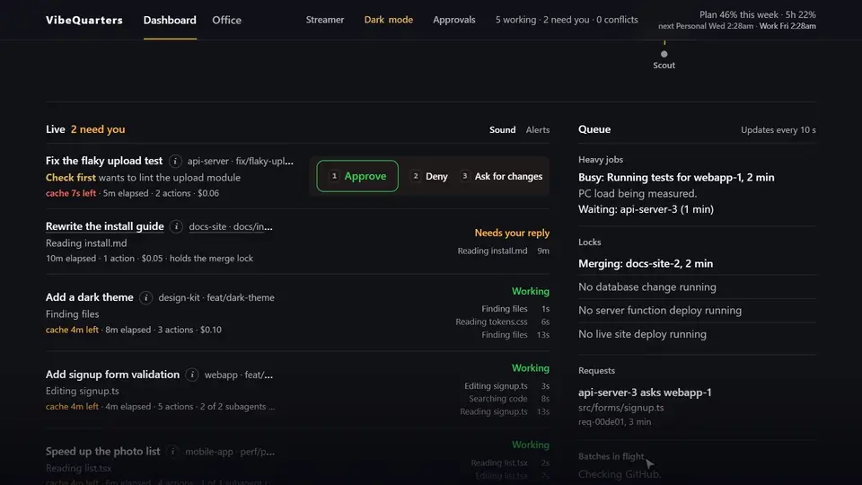
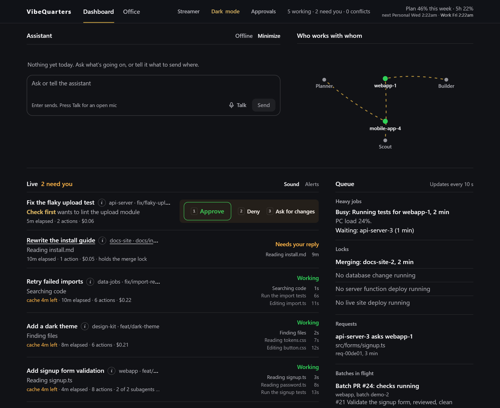
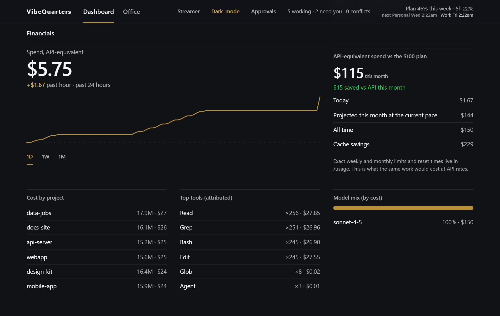
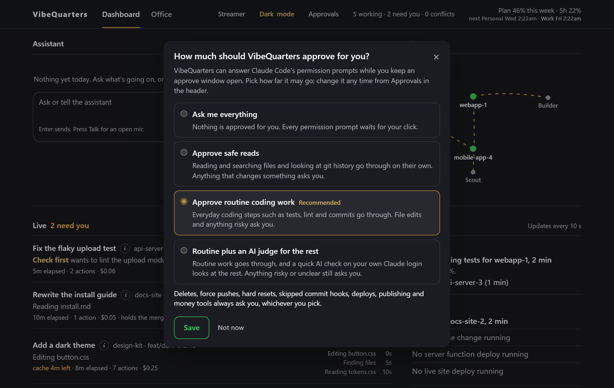
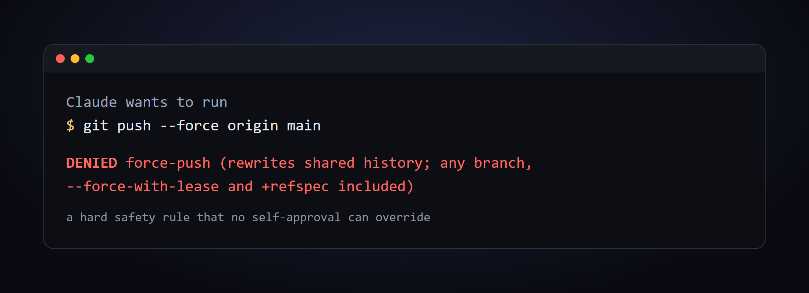
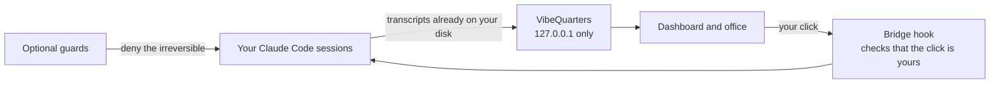

<div align="center">

# VibeQuarters

### Your Claude Code sessions, as a team you can see.

Run six sessions at once without losing track of one.<br>
One page shows what each is doing, what it costs, and which one needs you.

[](https://github.com/KinetykStudios/vibequarters/actions/workflows/ci.yml) [](LICENSE)   

[](https://kinetykstudios.github.io/vibequarters/)

**[▶ Watch the 37-second film](https://kinetykstudios.github.io/vibequarters/)** · **[Try it in one minute](#try-it-in-one-minute)** · **[What you get](#what-you-get)** · **[Is it safe?](#is-it-safe)** · **[FAQ](#faq)**

</div>

## Try it in one minute

```sh
git clone https://github.com/KinetykStudios/vibequarters
cd vibequarters
npm run demo
```

Open <http://127.0.0.1:7790/>. That is all of it: no `npm install`, no account, no API key, no Claude login. You get six made-up sessions, a prompt to approve (answering from the page is Windows only so far), and the office. Your own sessions are never read, and it writes only in its own folder. You need [Node.js](https://nodejs.org) 22 or newer and [git](https://git-scm.com).

Like it? This one shows **your** sessions, read-only:

```sh
npm start
```

## Sound familiar?

You start one Claude Code session. Then a second, for the bug. A third, for the docs. By the sixth:

| Without it | With VibeQuarters |
| --- | --- |
| One session has sat on "Allow this command?" for twenty minutes in a window you forgot | It raises its hand, goes to the top of the page, and you press `1` |
| Two sessions edit the same file, and you find out at the merge | Each file has one owner. The second session asks the first |
| You learn what it cost when the limit hits | Cost, context and plan usage per session, live |
| You approve 60 harmless `git status` prompts a day | You pick a level once. Deletes, force pushes, deploys and money still ask, when the command itself says so ([limits](SECURITY.md)) |
| `git push --force` to `main`, at 2 in the morning | Denied, in every spelling the guard can read |
| You close the laptop and the next session starts from zero | Each project keeps its lessons and its resume point |

## What you get

### An office you can read at a glance

Every live session is a person at a desk. Their screens show the file they are in. A gold mark and a raised hand mean *this one needs you*. Arcs show which subagent works for which session. Walk around, click anyone.


### One click, and it goes on

A prompt arrives with what it does in plain words. Press `1` to approve, `2` to deny, `3` to send it back with a note. No hunting for the right window. (Windows so far: [why](docs/guide.md#answering-prompts-from-the-page).)



### Everything on one page

Who is working, on what, for how long, waiting on what. Who helps whom. Which test run holds the machine, which merge is in line.



### Know what it costs

By day, week and month, by project, by tool, by model, next to your plan's price.



### You decide how much it may approve

Four levels, from *ask me everything* to *routine work plus an AI judge*. It acts only inside a window of time that you open. Deletes, force pushes, hard resets, deploys, publishing and money wait for you at every level, when the command itself says so: a script file that does the same is not read ([limits](SECURITY.md)).



### Guards for the bad day

The optional system pack stops the commands you cannot take back, in every spelling it can read: quoted, escaped, behind `sudo` or `bash -c`, or as a `+` refspec.



### Sessions that work as a team

The pack also gives them a shared board: each owns the files it edits, asks the owner for a change, and takes turns on merges, migrations and deploys. A merge needs a fresh reviewer to have passed that exact commit.


<sub>Every picture and clip on this page is the built-in demo, with made-up sessions, except the terminal in the guard picture and film shot, which is drawn. The people are from Microsoft's MIT-licensed Rocketbox library.</sub>

## Pick your depth

| | What you do | What you get |
| --- | --- | --- |
| **1. Look** | `npm run demo` | The whole thing, with made-up sessions |
| **2. Watch** | `npm start` | Your real sessions, read-only. It writes only its own state files |
| **3. Run it** | `node install/install.js` | Answer from the page, guards, the shared board, the merge gate. You choose each pack |

Step 3 shows you everything first and writes nothing until you say so:

```sh
node install/install.js --dry-run   # what would change
node install/install.js             # asks what to turn on
```

Changed your mind? One command takes it all out and puts your settings back:

```sh
node "$HOME/.claude/vibequarters/install/uninstall.js"
```

## Your first day

1. **Leave the page open** on a second screen and work as you always do.
2. **Start more sessions than you dare to.** Each one takes a desk by itself.
3. **When a hand goes up,** press `1`, `2` or `3`.
4. **Click a person** to see their steps, their files, their cost, and to send them a message.
5. **Recording or sharing your screen?** **Streamer** hides every name and title.

## How it works



Claude Code already writes a transcript of each session. VibeQuarters reads those files and draws them. Answering goes back through a Claude Code hook that you install, which acts only on an answer the running page confirms it wrote. If anything fails, Claude Code asks you in its own window, as it always did.

## Is it safe?

- **It listens on `127.0.0.1` only.** No account, no server of ours, no telemetry.
- **Nothing leaves your computer by default.** Every feature that calls out is off until you turn it on, and [each one is listed](SECURITY.md#every-outbound-call).
- **No npm dependencies.** Nothing to install, nothing to get hijacked. The one library, Three.js, is in the repo with its checksums.
- **Read-only until you say otherwise.**
- **What looks like a key or token is cut** from transcript text before it reaches the page, best effort: a secret written as plain words can get through.
- **It is tested:** over 1,700 tests, on Windows, macOS and Linux.

It is a second pair of eyes, not a sandbox: [SECURITY.md](SECURITY.md) says what it does not protect you from.

## FAQ

<details><summary><b>Do I need an API key?</b></summary><br>No. It reads the sessions you already run with your own Claude Code login. The optional AI judge and assistant use that same login.</details>

<details><summary><b>Does it slow Claude Code down?</b></summary><br>Watching does not touch Claude Code at all: it reads files. The hooks in the system pack run before a tool call, each as its own short process.</details>

<details><summary><b>Does it work with the terminal, VS Code and the desktop app?</b></summary><br>Any Claude Code session that writes its transcript to <code>~/.claude/projects</code> on this computer shows up. Cloud sessions and other computers do not.</details>

<details><summary><b>What does not work on macOS and Linux?</b></summary><br>Answering prompts, sending messages and opening a new session from the page are Windows only so far: the first two depend on a Windows process check we will not skip. Watching, the office, costs, guards, the shared board and the merge gate work on all three.</details>

<details><summary><b>Can I use my own office, names and looks?</b></summary><br>Yes: rooms, names, colors and which person sits where are in <code>hq.config.json</code>. See <a href="docs/guide.md#configure">Configure</a>.</details>

<details><summary><b>What does it change on my computer?</b></summary><br><code>npm run demo</code> and <code>npm start</code>: nothing in your Claude setup. The installer lists every file and setting first, backs up your settings, and the uninstaller puts them back.</details>

<details><summary><b>Is it made by Anthropic?</b></summary><br>No. It is an independent open-source project, not made, endorsed or supported by Anthropic.</details>

## Read more

| | |
| --- | --- |
| [The full guide](docs/guide.md) | Every pack, setting, panel and default |
| [How sessions share work](system/docs/session-coordination.md) | Ownership, requests, locks |
| [How memory works](system/docs/memory.md) | Lessons and resume points |
| [SECURITY.md](SECURITY.md) | What it protects, what it does not, how to report |
| [CONTRIBUTING.md](CONTRIBUTING.md) | Report a bug, ask for a feature |

## License

[MIT](LICENSE). Third-party code and models are listed in [THIRD_PARTY_NOTICES.md](THIRD_PARTY_NOTICES.md). Made by [Kinetyk](https://kinetyk.studio).

<div align="center">

**If it saves you one forgotten prompt, give it a star so the next person finds it.**

</div>
